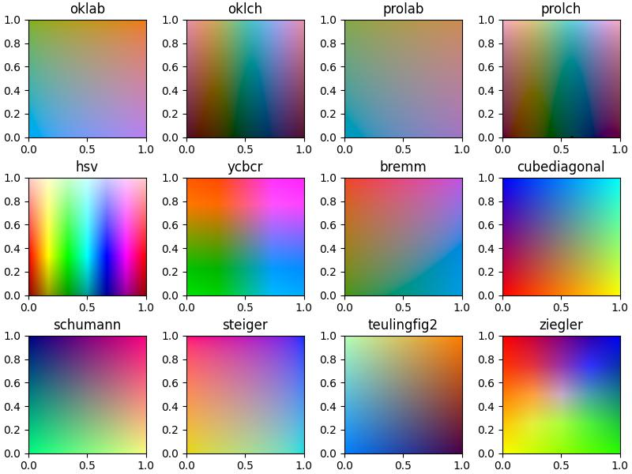
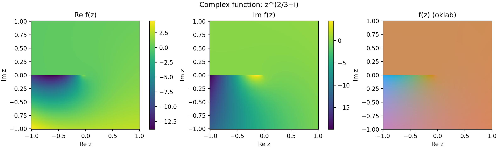
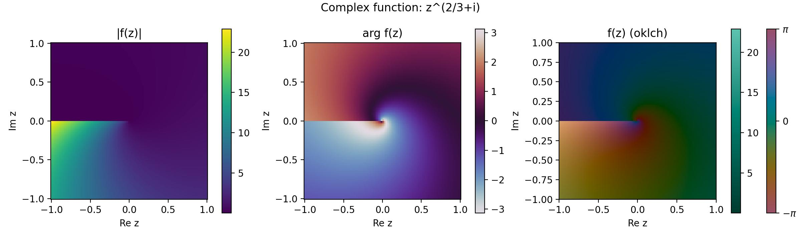
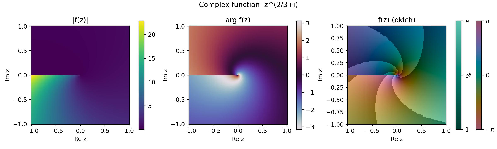

# Colormap Complex

<p align="center">
  <a href="https://github.com/34j/colormap-complex/actions/workflows/ci.yml?query=branch%3Amain">
    
  </a>
  <a href="https://colormap-complex.readthedocs.io">
    
  </a>
</p>
<p align="center">
  <a href="https://codecov.io/gh/34j/colormap-complex">
    
  </a>
  <a href="https://github.com/astral-sh/uv">
    
  </a>
  <a href="https://github.com/astral-sh/ruff">
    
  </a>
  <a href="https://github.com/j178/prek">
    
  </a>
</p>
<p align="center">
  <a href="https://pypi.org/project/colormap-complex/">
    
  </a>
  
  
</p>

---

**Documentation**: <a href="https://colormap-complex.readthedocs.io" target="_blank">https://colormap-complex.readthedocs.io </a>

**Source Code**: <a href="https://github.com/34j/colormap-complex" target="_blank">https://github.com/34j/colormap-complex </a>

---

Complex / 2d colormap

## Installation

Install this via pip (or your favourite package manager):

```shell
pip install colormap-complex
```

## Usage

```python
from colormap_complex import colormap
import numpy as np

lin = np.linspace(-1, 1, 100)
x, y = np.meshgrid(lin, lin)
z = x + 1j * y
c = colormap(type="oklab")(z.real, z.imag, scale=True)
plt.imshow(c, extent=(-1, 1, -1, 1), origin='lower')
```

### All colormaps



### Examples





### Description

- `"bremm", "cubediagonal", "schumann", "steiger", "teulingfig2", "ziegler"` colormaps are collected from [spinthil/pycolormap-2d](https://github.com/spinthil/pycolormap-2d) which is based on:
  > M. Steiger, J. Bernard, S. Thum, S. Mittelstädt, M. Hutter, D. A. Keim, and J. Kohlhammer, “Explorative Analysis of 2D Color Maps,” in International Conferences in Central Europe on Computer Graphics, Visualization and Computer Vision, 2015, vol. 23, pp. 151–160.
- Other colormaps are built on top of [colour-science/colour](https://github.com/colour-science/colour) and created by the author.
- `"oklab", "prolab"` are perceptually uniform (lightness) colormaps.
- `"oklch", "prolch"` are perceptually uniform (chroma) colormaps. X axis corresponds to Hue and Y axis to Lightness.

## Alternatives

- [nschloe/cplot: :rainbow: Plot complex functions](https://github.com/nschloe/cplot/tree/main)
